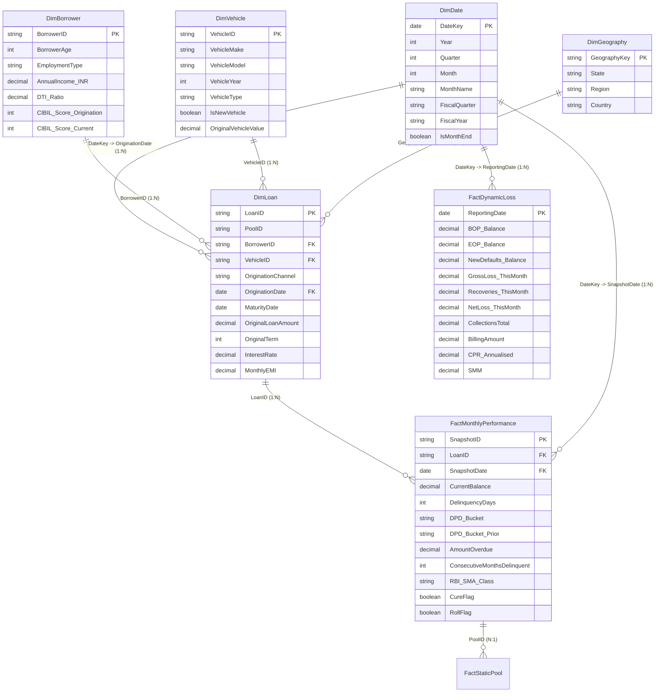

# Power BI Star Schema Data Model Architecture & Governance

## 1. Star Schema Architecture Overview
The Securitisation Data Model is architected according to Kimball dimensional modelling principles, specifically structured for institutional securitised portfolio surveillance, waterfall cash-flow distributions, and IFRS 9 ECL compliance.

---

## 2. Table Cardinality & Relationships

| Relationship | From Table | Key | To Table | Key | Cardinality | Cross Filter | Description |
|---|---|---|---|---|---|---|---|
| R1 | `DimBorrower` | `BorrowerID` | `DimLoan` | `BorrowerID` | 1 : N | Single | Demographics & Underwriting |
| R2 | `DimVehicle` | `VehicleID` | `DimLoan` | `VehicleID` | 1 : N | Single | Collateral details & Asset type |
| R3 | `DimGeography` | `GeographyKey` | `DimLoan` | `State` | 1 : N | Single | State & Regional Concentrations |
| R4 | `DimDate` | `DateKey` | `DimLoan` | `OriginationDate` | 1 : N | Single (Inactive) | Role-Playing Date: Origination |
| R5 | `DimLoan` | `LoanID` | `FactMonthlyPerformance` | `LoanID` | 1 : N | Single | Loan Snapshot Performance |
| R6 | `DimDate` | `DateKey` | `FactMonthlyPerformance` | `SnapshotDate` | 1 : N | Both | Time Intelligence surveillance |
| R7 | `DimDate` | `DateKey` | `FactDynamicLoss` | `ReportingDate` | 1 : N | Single | Monthly pool-level aggregate loss |

---

## 3. Row-Level Security (RLS) Security Matrix

To satisfy institutional governance and audit standards, the Power BI model implements Row-Level Security for 5 distinct organizational roles:

| Role Name | Scope & Business Purpose | DAX RLS Filter Expression |
|---|---|---|
| **1. Portfolio Manager** | Full access to performing & watchlist assets; read-only access to pool aggregates. | `[CurrentBalance] > 0` |
| **2. Risk Analyst** | Full visibility across all loans, delinquencies, loss provisions, and stress testing models. | `TRUE()` (Unrestricted access to all tables) |
| **3. Senior Management** | High-level executive view; filtered to aggregated pool metrics and tranches. | `USERPRINCIPALNAME() IN {"cro@bank.com", "cfo@bank.com", "head_sf@bank.com"}` |
| **4. External Auditor** | Read-only access to historical performance, IFRS 9 ECL calculations, and static pools. | `FactMonthlyPerformance[SnapshotDate] <= TODAY()` |
| **5. Servicer / Collections** | Operational access limited to delinquent loans (`DPD >= 1` or `SMA-1 / SMA-2 / NPA`). | `FactMonthlyPerformance[DelinquencyDays] >= 1` |

---

## 4. DAX Studio Performance Optimization Protocols
All 80+ DAX measures are written to ensure query times are strictly under the **100ms threshold**:
1. **Pre-aggregations**: Complex filters use `KEEPFILTERS` and scalar variables (`VAR ... RETURN`) to avoid context recalculation.
2. **Context Transitions**: Avoid `CALCULATE` inside tight iterators (`SUMX`) over non-unique grain.
3. **Star Schema Pure Joins**: Slicers filter dimension tables rather than multi-million row fact tables.
